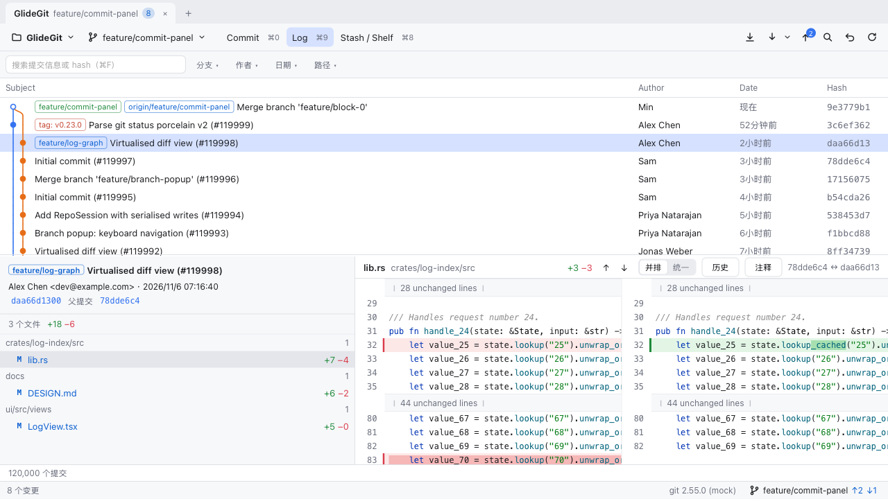
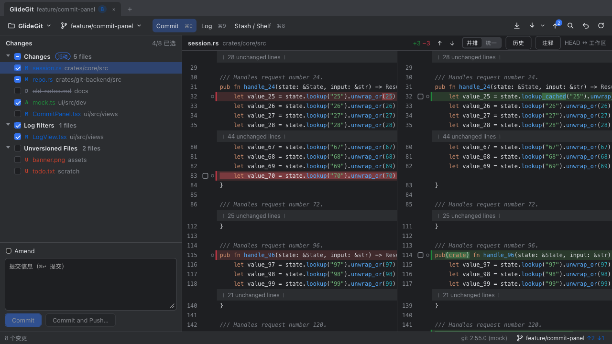

# GlideGit

跨平台（macOS / Windows）Git 图形客户端，交互体验对标 IntelliJ IDEA 的 Git 集成：快、就地操作、键盘优先。



## 功能

- **提交**：按 Changelist 分组的修改列表，勾选即暂存；并排 / 统一 diff，按块或按行暂存、丢弃；Amend、提交并推送、Rollback。
- **Shelve 与 Stash**：把一部分修改搁置起来或存入 stash，之后取回。
- **Log**：百万级提交的仓库也能秒开，提交图、过滤（文本、作者、日期、分支、路径）、提交详情；右键 cherry-pick、还原、重置、新建分支 / 标签。
- **交互式 rebase**：图形化重排、squash、fixup、reword、drop、edit。
- **冲突**：三方合并工具，进行中的合并 / rebase 有引导横幅。
- **追溯**：Annotate、文件历史、选区历史、分支比较。
- **远程**：Fetch、Pull、推送前预览、Force Push（with-lease），后台运行可取消；账号密码与 SSH 口令在应用内回答。
- **撤销中心**：提交、切换分支、重置、回滚、搁置等操作都可以安全撤销。
- **键盘优先**：IntelliJ IDEA 键位（可自定义），命令面板（⌘⇧A / Ctrl+Shift+A 或双击 Shift）。
- **其他**：中文 / 英文界面、多仓库标签页、浅色 / 深色主题、应用内自动更新；Windows 安装包附带 MinGit，没装 git 也能用。

完整列表见 [CHANGELOG.md](CHANGELOG.md)。



## 下载与安装

从 [GitHub Releases](https://github.com/ming2502/GlideGit/releases/latest) 下载最新版本。之后的新版本会在应用内提示，一键更新。

| 平台 | 文件 | 要求 |
|---|---|---|
| macOS（Apple 芯片与 Intel） | `GlideGit_<版本>_universal.dmg` | macOS 11 或更新；git（Xcode 命令行工具或 Homebrew 自带） |
| Windows（64 位） | `GlideGit_<版本>_x64-setup.exe`（推荐，按当前用户安装，不需要管理员权限）或 `.msi`（按机器安装） | Windows 10 / 11；WebView2（没有时安装程序自动安装）；git 可选，没有时使用自带的 MinGit |

目前的安装包还没有做 Apple / Windows 代码签名，第一次打开时系统会拦一下：

- **macOS**：把 GlideGit 拖进「应用程序」后打开，系统提示「无法验证开发者」时，到「系统设置 → 隐私与安全性」，在下方找到 GlideGit，点「仍要打开」。也可以在终端执行：

  ```bash
  xattr -dr com.apple.quarantine /Applications/GlideGit.app
  ```

- **Windows**：SmartScreen 提示「Windows 已保护你的电脑」时，点「更多信息」，再点「仍要运行」。

只需要允许一次，之后的自动更新不会再提示。

## 文档

- 设计文档：[docs/DESIGN.md](docs/DESIGN.md)
- 工作计划：[docs/ROADMAP.md](docs/ROADMAP.md)
- 更新日志：[CHANGELOG.md](CHANGELOG.md)
- 发布与签名：[docs/RELEASING.md](docs/RELEASING.md)
- 测试：[docs/TESTING.md](docs/TESTING.md)

## 技术栈

Tauri 2 · Rust（`crates/`）· React + TypeScript（`ui/`）· 系统 git CLI

```
crates/git-backend  git CLI 封装、porcelain 解析、领域模型（导出 TS 类型）
crates/log-index    Log 提交索引：流式首屏、SQLite 落盘、增量更新
crates/core         RepoSession：串行写、文件监听、快照发布、索引更新、操作日志与撤销
crates/bench        性能基准：生成大仓库，对照设计文档的性能目标逐项检查
crates/app          Tauri 入口与 IPC 命令
ui/                 前端（Vite + React + Zustand）
```

## 开发

前置：Rust stable、Node 24+、pnpm、git ≥ 2.30。

```bash
pnpm install
pnpm tauri dev        # 启动桌面应用
pnpm dev              # 仅前端，在浏览器中用 mock 数据预览 UI
cargo test --workspace
pnpm test             # 前端单元测试（vitest）
pnpm e2e              # 截图回归测试（Playwright，见 docs/TESTING.md）
pnpm bindings         # Rust 模型变更后重新生成 ui/src/bindings
cargo run --release -p glide-log-index --example bench -- <仓库路径>   # Log 索引基准
cargo run --release -p glide-git-backend --example refresh -- <仓库路径>   # 刷新耗时基准
cargo run --release -p glide-bench -- [--commits N] [--only log,open,branches,diff,save]   # 性能目标逐项检查（DESIGN §1.2）
```

## 快捷键（IntelliJ 预设）

以下为默认键位，可在「设置 → 快捷键」中修改。

| 动作 | macOS | Windows |
|---|---|---|
| 聚焦提交信息 | ⌘K | Ctrl+K |
| 提交 | ⌘↩ | Ctrl+Enter |
| 提交并推送 | ⌘⌥K | Ctrl+Alt+K |
| 推送 | ⌘⇧K | Ctrl+Shift+K |
| 拉取（Update Project） | ⌘T | Ctrl+T |
| 分支弹窗 | ⌘⇧\` / ⌘B | Ctrl+Shift+\` / Ctrl+B |
| Commit / Log / Stash·Shelf 视图 | ⌘0 / ⌘9 / ⌘8 | Ctrl+0 / Ctrl+9 / Ctrl+8 |
| Stash 修改 | ⌘⇧S | Ctrl+Shift+S |
| Log 中搜索 | ⌘F | Ctrl+F |
| 下一处 / 上一处修改（diff） | F7 / ⇧F7 | F7 / Shift+F7 |
| 刷新 | ⌘R / F5 | Ctrl+R / F5 |
| Rollback 选中文件 | ⌘⌥Z | Ctrl+Alt+Z |
| 命令面板（Find Action） | ⌘⇧A 或双击 Shift | Ctrl+Shift+A 或双击 Shift |
| 设置 | ⌘, / ⌘⌥S | Ctrl+, / Ctrl+Alt+S |
| 撤销中心（撤销最近的操作） | ⌘⇧U | Ctrl+Shift+U |
| 移动到另一个 Changelist | F6 | F6 |
| 下一个 / 上一个仓库标签 | ⌘⇧] / ⌘⇧[ 或 ⌃Tab / ⌃⇧Tab | Ctrl+Shift+] / Ctrl+Shift+[ 或 Ctrl+Tab |
| 关闭仓库标签 | ⌘⌥W | Ctrl+Alt+W |
| 变更列表：切换 / 勾选 | ↑↓ / 空格 | ↑↓ / Space |

## 许可证

GlideGit 以 [Apache License 2.0](LICENSE) 发布。Windows 安装包附带的 MinGit 按 GPLv2 原样分发，见 [NOTICE](NOTICE)。
